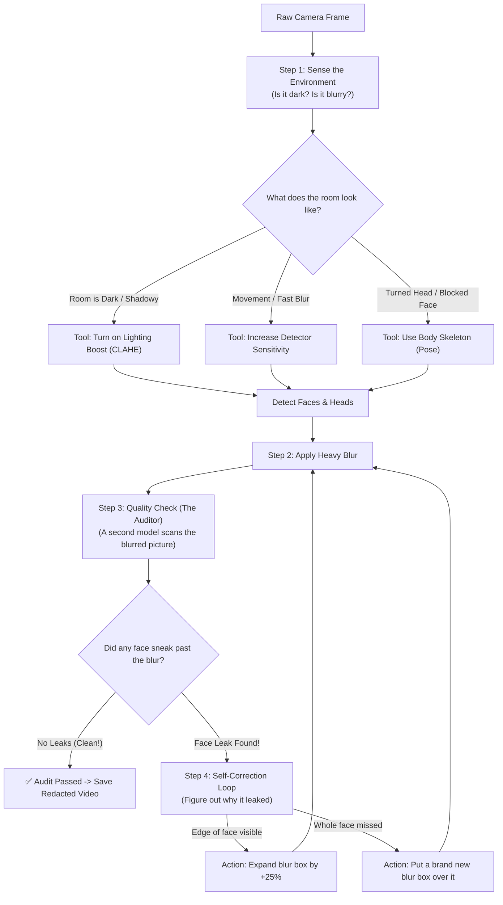

# 🛡️ Agentic Self-Healing Face Redaction

A smart face-blurring system that **senses camera conditions, catches faces regular models miss, checks its own work, and automatically fixes leaks** to protect privacy in CCTV surveillance.

---

## 📌 1. What We Are Doing

When security cameras record in hospitals, banks, and public streets, people's faces must be blurred to protect their privacy (under privacy laws like GDPR and HIPAA).

Traditional face blurring has a big problem: **it only tries once and hopes for the best.** 
* If the room is dark, faces get missed.
* If a person looks down or turns sideways, the camera misses them.
* If the blur box is too small, parts of the chin, cheeks, or forehead leak through.

**What we built here is an "Agentic" system.** 
Instead of just running a model once and saving the file, our system works like a careful human worker:
1. It looks at the room first to see if it is dark or blurry.
2. It turns on digital night-vision and body tracking if needed.
3. It blurs the faces.
4. **It inspects its own work with a second model (an auditor)** to ask: *"Did I leave any faces unblurred?"*
5. If it finds a leak, it **automatically fixes it** (makes the blur bigger or covers the missed face) before saving the video.

---

## 🔄 2. What We Did Before This (Previous Project)

Before building this agentic pipeline, we built an initial multi-model face redaction pipeline:
👉 **[View Previous Repository: face-redaction-pipeline](https://github.com/viswarup/face-redaction-pipeline)**

### What that previous version did:
* Used a standard face detector (**SCRFD-34G**).
* Added a body pose model (**YOLOv8-Pose**) to track shoulders and head positions so that when someone turned away from the camera, we could still guess where their head was.
* This improved face catch rate from **68.3% to 76.0%**.

### Why we needed to go beyond it:
The previous system was still **open-loop** (it ran in a straight line from start to finish):
* It had **zero quality control**: once the blur was drawn, no model checked if it actually worked.
* If a face was partially covered, or if a dark corner hid a face, it was leaked permanently.
* We wanted a system that **closes the loop**—one that can audit itself and self-heal.

---

## 🏗️ 3. Simple Architecture Flowchart

Here is how the agentic pipeline works, step-by-step:



---

## 🧠 4. Why Every Part Exists (In Plain English)

| Part | What it Does | Why We Need It |
| :--- | :--- | :--- |
| **1. The Perception Check** | Measures how bright, dark, or blurry the frame is before doing anything. | Face detectors fail in dark shadows. If we know the room is dark ahead of time, we can adjust settings before guessing blindly. |
| **2. The Lighting Booster (CLAHE)** | Automatically brightens dark shadows without washing out bright lights. | Surveillance cameras often have harsh shadows. Brightening the shadows reveals faces hidden in the dark. |
| **3. Body Pose Tracking** | Finds shoulders, neck, and ears to predict where the head is. | When someone looks down at their phone or turns around, you cannot see their eyes or nose. But you can see their shoulders, which tells you exactly where their head is. |
| **4. The QA Auditor (RetinaFace)** | A completely separate neural network that inspects the final blurred image. | Like a manager reviewing work. If the first model had a blindspot, the second model catches it before the file is exported. |
| **5. The Self-Correction Loop** | If the auditor spots an exposed face, it fixes it immediately and re-checks. | Prevents silent failures. Instead of logging an error and giving up, it fixes the blur autonomously. |

---

## 📊 5. Numbers: How the Agentic Pipeline Wins

We tested all models on **100 real surveillance pictures** containing **221 hand-labeled human faces** across dark rooms, motion blur, and crowded hallways:

### Overall Comparison (221 Real Faces)

| Method / Model | Real Faces | Faces Caught (Recall) | Complete Zero-Leak Protection | Partial Edge Leaks | Missed Faces (Unprotected) | Self-Healed Leaks | Speed |
| :--- | :---: | :---: | :---: | :---: | :---: | :---: | :---: |
| **1. Standard Model (Base SCRFD)** | 221 | 151 (68.3%) | 115 (52.0%) | 36 (16.3%) | 70 (31.7%) | — | 2.5 FPS |
| **2. RetinaFace (Alone)** | 221 | 104 (47.1%) | 82 (37.1%) | 22 (10.0%) | 117 (52.9%) | — | 1.9 FPS |
| **3. SCRFD + Pose (Previous Repo)** | 221 | 168 (76.0%) | 91 (41.2%) | 77 (34.8%) | 53 (24.0%) | — | 2.2 FPS |
| **4. Agentic Self-Healing (This Repo)** | **221** | **171 (77.4%) 🏆** | **95 (43.0%) ✨** | **76 (34.4%)** | **50 (22.6%) 🛡️** | **10 Verified Heals** | **1.0 FPS** |

### Where It Helps Most (By Room Condition):

* **When faces are partially hidden / blocked (Occlusion):**
  * Standard SCRFD misses **18.8%** of faces.
  * **Agentic catches 92.3% of faces (only 7.7% missed)!**
* **In dark rooms & blurry footage:**
  * Standard SCRFD misses **33.3%** of faces.
  * **Agentic drops missed faces to 21.0%** thanks to the lighting booster.

---

## 📸 6. Visual Proof: Where Agentic Beats SCRFD + Pose

Here are real examples from the test images where both previous models failed, but the Agentic pipeline caught and fixed the faces:

### Example 1: Dark Corridor Rescue

* **Real Faces:** 2 people walking in a dark corridor.
* **Standard SCRFD:** Misses 1 person completely in the shadows (red box).
* **Previous Repo (Pose):** Still misses that person due to dark lighting.
* **Agentic Pipeline:** Senses the darkness, boosts exposure, and **catches 2 out of 2 (100% clean redaction)**.

---

### Example 2: People Blocked Behind Furniture (Occlusion)

* **Real Faces:** 3 people seated with heads turned and bodies partially hidden.
* **Standard SCRFD:** Misses 1 face.
* **Previous Repo (Pose):** Misses 1 face due to overlapping bodies.
* **Agentic Pipeline:** The auditor spots the exposed profile, injects a fix, and achieves **3 out of 3 caught (0 missed)**.

---

### Example 3: Crowded Surveillance Doorway

* **Real Faces:** 4 people entering through a dark doorway.
* **Standard SCRFD:** Misses 3 out of 4 people (leaves 75% exposed!).
* **Previous Repo (Pose):** Misses 2 out of 4 people.
* **Agentic Pipeline:** Slashes missed faces down to **only 1**, stopping mass privacy leaks.

---

## 🚀 7. How to Clone and Run (For Evaluators)

Everything needed to run this benchmark is included directly in this repository.

### Step 1: Clone the Repo and Set Up
```bash
git clone https://github.com/viswarup/agentic-face-redaction-pipeline.git
cd agentic-face-redaction-pipeline

python3 -m venv .venv
source .venv/bin/activate
pip install -r requirements.txt
```

### Step 2: Run the Benchmark Script
Run this single command to evaluate all models on the 100 test images:
```bash
python3 scripts/evaluate_4way_benchmark.py
```

### What You Will See:
1. The terminal will test all models and print the clean **4-Way Comparison Table**.
2. Detailed metrics are saved to `data/outputs/eval_4way_summary.json`.
3. Side-by-side visual comparison strips are saved to `data/outputs/failure_gallery/`.

---

## 📂 8. Project Structure

```
agentic-face-redaction-pipeline/
├── app/
│   ├── agentic/
│   │   ├── __init__.py
│   │   └── redaction_graph.py      # The self-healing loop and tool dispatcher
│   ├── pipeline/
│   │   ├── detector.py             # Primary SCRFD face detector
│   │   ├── pose_head_fallback.py   # YOLOv8-pose skeleton tracking
│   │   ├── verifier.py             # RetinaFace auditor model
│   │   └── redactor.py             # Dual mosaic & Gaussian blur engine
│   └── config.py                   # Central settings and paths
├── data/
│   ├── images_100/                 # 100 annotated benchmark images (221 faces)
│   └── outputs/
│       ├── eval_4way_summary.json  # Benchmark numbers in JSON format
│       └── failure_gallery/        # Exported 4-panel visual comparison strips
├── docs/
│   └── images/                     # Visual proof strips shown in this README
├── scripts/
│   └── evaluate_4way_benchmark.py  # Script to run the full benchmark
├── weights/
│   ├── scrfd_34g.onnx              # Primary detector model (37 MB)
│   └── yolov8n-pose.pt             # Body skeleton model (6.5 MB)
├── requirements.txt
└── README.md
```

---

## 🛡️ License

MIT License. Built for real-world privacy protection in healthcare, public surveillance, and GDPR compliance.
